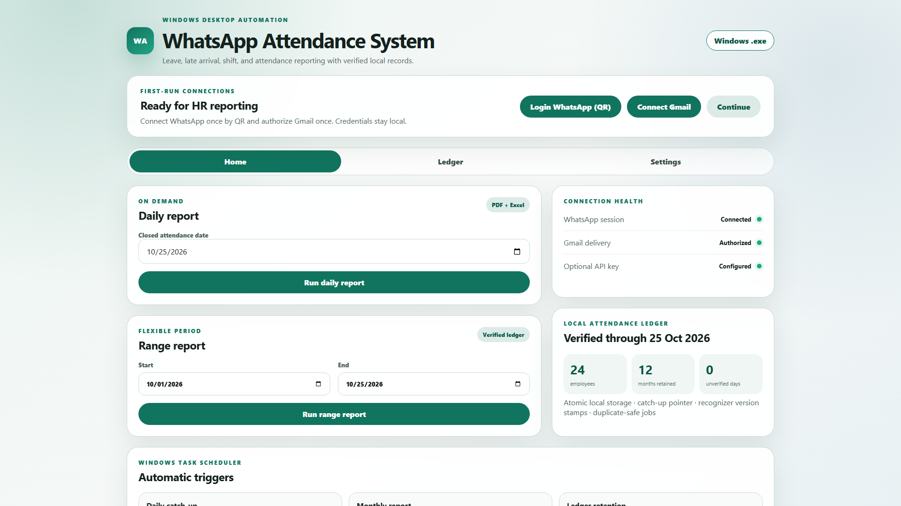
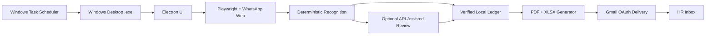

# WhatsApp Attendance System — Leave, Late & HR Report Automation

> [!IMPORTANT]
> **Public portfolio subset.** This repository intentionally contains only selected, sanitized examples and a frontend preview. The complete production application, private business rules, customer data, credentials, installers, and backend automation are not public.

A Windows desktop attendance solution that reads an authorized WhatsApp group with **Playwright**, converts messages into verified attendance records, tracks leave and lateness, generates **PDF and Excel (`.xlsx`) reports**, and automatically emails completed reports to HR through **Gmail OAuth**.

The production application is packaged as an installable **Windows `.exe`** and registers its recurring jobs with Windows Task Scheduler.

_Sanitized UI preview generated with fictional employees, dates, connection states, and metrics._

## Product goals

- Replace manual attendance review without requiring employees to learn another application
- Reuse the organization’s existing WhatsApp attendance group
- Preserve an auditable local ledger instead of recalculating history from chat every time
- Prevent incomplete or unverified attendance periods from being emailed to HR
- Deliver repeatable PDF and spreadsheet reports automatically
- Support day shifts, night shifts, leave, lateness, work from home, early exits, breaks, and incomplete attendance

## Key features

### Windows desktop `.exe`

- Electron-based desktop interface distributed as a Windows installer
- Guided first-run flow for WhatsApp QR login and Gmail authorization
- Home dashboard for daily and custom-range reports
- Employee, WhatsApp, Gmail, report-path, and connection settings
- Local-first storage: credentials, browser profiles, attendance records, and generated reports remain on the authorized computer
- Installed scheduled jobs can run the same executable in background automation modes

### WhatsApp attendance collection with Playwright

- Opens a visible Chromium session through Playwright
- Uses one persistent local browser profile after the HR user scans the WhatsApp Web QR code
- Opens only the configured attendance group
- Collects message text, sender identity, message time, reply context, and date boundaries
- Handles scrolling and verifies that the required date window was actually reached
- Avoids authentication bypasses and unofficial WhatsApp protocol libraries
- Leaves ambiguous or unverified days visible for review instead of silently inventing attendance

### Attendance, leave, and late tracking

The deterministic recognition layer supports:

- Sign in and sign out, including common clock formats and typing variations
- Day and night shifts, including sign-out after midnight
- Late arrival and preserved late-reason text
- Early sign out and incomplete attendance
- Missing sign in or missing sign out
- Temporary sign out and return-to-work breaks
- Work-from-home and remote-work notes
- Self-reported leave, leave reported by another person, and dated leave ranges
- Weekends, public holidays, and scheduled weekday rules
- Aliases and exact WhatsApp sender-name mappings
- Duplicate-safe message handling and visible review items for unresolved cases

Actual attendance totals, verified hours, statuses, and report rows are produced by deterministic local code. An optional API key may assist with ambiguous natural-language messages and management narrative text, but it does not replace the verified ledger or calculate authoritative attendance totals.

## Verified local ledger

The ledger is the system of record for reporting and automation.

- Stores attendance by closed workday in a local JSON ledger
- Uses atomic writes to avoid partial-file corruption
- Prevents the same source message from being processed twice
- Records collection coverage so an incomplete WhatsApp scan cannot appear verified
- Uses a catch-up pointer that advances only through a contiguous sequence of verified days
- Stores recognizer-version stamps so older days can be re-evaluated after recognition improvements
- Uses run locks to prevent overlapping scheduled jobs
- Tracks scheduler outcomes for operational visibility
- Retains a rolling year of ledger history and removes only complete expired months
- Keeps employee configuration and the WhatsApp browser profile separate from ledger retention

### Workday closing rule

A workday closes at **08:00 Asia/Karachi on the following morning**, allowing night-shift sign-outs to be included. Same-day attendance cannot be finalized or reported while it is still open.

## PDF and spreadsheet reporting

The application generates:

- Daily reports
- Weekly reports
- Monthly reports
- Custom date-range reports
- PDF documents for HR review and archiving
- Excel `.xlsx` workbooks that can also be opened in Google Sheets

Reports can include attendance status, shift, sign-in/out times, verified hours, late or early-exit details, leave reporter, notes, period totals, and a management summary. Generated files are stored locally under the configured reports directory before delivery.

## Gmail delivery to HR

- Gmail is connected once through OAuth using a desktop application client
- OAuth tokens remain local and are never committed to source control
- Scheduled jobs attach both the PDF and `.xlsx` report
- Catch-up periods are combined into one HR email instead of sending duplicate messages
- Successfully emailed dates and monthly cycles are recorded so repeated triggers safely become no-ops
- Failed or incomplete periods remain pending for the next retry

## Automatic trigger schedule

| Automation | Trigger | Behavior |
| --- | --- | --- |
| Daily catch-up and HR email | Monday–Friday at **12:00, 13:00, 14:00, 15:00, 16:00, and 17:00** | Collects every pending closed day, verifies coverage, updates the ledger, generates PDF/XLSX, and emails one catch-up report to HR. Later triggers no-op after success. |
| Monthly HR report | **11:30, 13:30, and 15:30** when a completed cycle is due | Builds the previous **21st through current 20th** report from the ledger only. Missing or unverified days block delivery and are retried. |
| Ledger retention | First day of the month, hourly from **12:00 through 17:00**, after the initial retention year | Removes complete months older than the rolling one-year retention window without deleting employees, settings, or the WhatsApp session. |

The installed tasks use start-when-available behavior, bounded runtime, duplicate-safe execution, and retry-friendly exit statuses.

## API-key configuration

An optional API key can be configured locally for:

- Interpreting attendance messages that deterministic rules cannot settle safely
- Returning structured actions that are validated before entering the ledger
- Producing a management narrative from anonymized aggregates

The key belongs only in a local `.env` file. The public template uses `AI_API_KEY`; no real key, token, model credential, or provider-specific configuration is committed.

## System architecture

## What this public repository includes

- Sanitized desktop UI preview in [`showcase/`](showcase/)
- Screenshot used in this README
- Selected Electron preload bridge showing the restricted renderer API surface
- Representative clock parsing and monthly-cycle utilities
- Safe environment, employee, and trigger examples
- Public documentation and confidentiality notice

## What is intentionally omitted

- Complete WhatsApp extraction and DOM-selection implementation
- Full attendance recognition and business-rule engine
- Gmail OAuth token handling and email-delivery implementation
- PDF/XLSX generation source
- Production ledger and employee data
- Browser profiles, credentials, API keys, logs, and generated reports
- Private automated tests and evaluation fixtures
- Packaging secrets, installer files, compiled application, and `.exe` binaries
- Complete production source and deployment configuration

## Preview the public UI

Open [`showcase/index.html`](showcase/index.html) directly in a browser. The controls intentionally do not execute production operations.

Example configuration files are available under [`examples/`](examples/). Copy values into private local configuration only; never commit real credentials or employee records.

## Privacy and security

Attendance records and WhatsApp sessions are sensitive. The production system keeps them local, separates configuration from the ledger, ignores credential/runtime paths in Git, and sends reports only to the configured HR address. This public repository contains fictional demonstration data only.

See [NOTICE.md](NOTICE.md) for the public-subset notice.

## Author

**Muhammad Humair**  
GitHub: [@humairyousaf6](https://github.com/humairyousaf6)  
Email: humairyousaf5254@gmail.com
